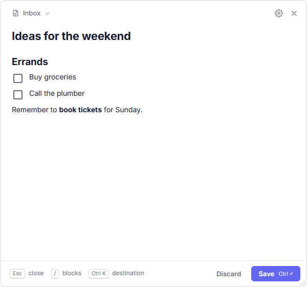

# Notion Quick Capture

[](https://github.com/somaraj/notion-quick-capture/actions/workflows/ci.yml)
[](https://github.com/somaraj/notion-quick-capture/releases/latest)
[](LICENSE)

Capture notes to Notion from anywhere. Press a global shortcut, type, hit <kbd>Ctrl</kbd>+<kbd>Enter</kbd> — the note lands in your Notion page or database, and you're back to what you were doing.

Runs quietly in the system tray on **Windows, macOS and Linux**.

<p align="center">
  <picture>
    <source media="(prefers-color-scheme: dark)" srcset="docs/images/capture-panel-dark.png">
    
  </picture>
</p>

**[Install](#install)** · **[Connect to Notion](#connect-to-notion)** · **[Usage](#usage)** ·
**[Troubleshooting](#troubleshooting)** · **[Privacy](#privacy--security)** · **[Develop](#develop)**

> Not affiliated with or endorsed by Notion Labs, Inc. "Notion" is a trademark of Notion Labs, Inc.

## Features

- **Global shortcut** — <kbd>Ctrl</kbd>+<kbd>Shift</kbd>+<kbd>N</kbd> (<kbd>⌘</kbd>+<kbd>⇧</kbd>+<kbd>N</kbd> on macOS) opens a floating capture panel from any app. Customizable.
- **Database-aware** — reads your database's schema and shows a form for its properties (select, multi-select, status, date, people, relation, checkbox, number, URL, email, phone, files…).
- **Markdown body** — headings, nested lists and to-dos, quotes, code blocks, tables, images, dividers, bold/italic/strikethrough/code and links become native Notion blocks (parsed with [markdown-it](https://github.com/markdown-it/markdown-it)).
- **Live formatting editor** — powered by [Milkdown](https://milkdown.dev): type `# ` for a heading, `- ` for a list or `[] ` for a to-do and see it formatted as you write, or press `/` for a block menu. Select text for a formatting toolbar.
- **Works offline** — if you're offline or Notion is down, the capture is queued locally and sent automatically once the connection is back.
- **Private by design** — talks only to `api.notion.com`. Your token is encrypted with your OS keychain. No telemetry, no analytics, no third-party servers.
- **Light & dark themes.**
- **Automatic updates** on Windows and Linux (AppImage); update notifications on macOS and `.deb`. **Settings → Updates** shows status and release notes, and has a Beta channel.

## Install

Download the latest version from the [Releases page](https://github.com/somaraj/notion-quick-capture/releases/latest):

| OS | File |
|---|---|
| Windows 10/11 (x64, also runs on ARM) | `notion-quick-capture-setup-<version>.exe` |
| macOS, Apple silicon | `notion-quick-capture-<version>-mac-arm64.dmg` |
| macOS, Intel | `notion-quick-capture-<version>-mac-x64.dmg` |
| Linux | `notion-quick-capture-<version>-linux-x86_64.AppImage` or `notion-quick-capture-<version>-linux-amd64.deb` |

### First launch on unsigned builds

Release builds are currently **not code-signed**, so your OS will warn you the first time:

- **Windows** — SmartScreen shows "Windows protected your PC". Click **More info → Run anyway**.
- **macOS** — the app is blocked as "unidentified developer" or "damaged". Move it to Applications, then either right-click it → **Open**, or run:
  ```sh
  xattr -dr com.apple.quarantine "/Applications/Notion Quick Capture.app"
  ```
- **Linux (AppImage)** — make it executable: `chmod +x notion-quick-capture-*.AppImage`. For secure token storage you need a running secret service (GNOME Keyring or KWallet), which most desktops already have.

Every release is built from this repository by [GitHub Actions](.github/workflows/release.yml), so you can verify exactly what went into it.

### Development builds

Want to try the latest unreleased changes? Every push builds installers for all three platforms. Open the
[CI runs](https://github.com/somaraj/notion-quick-capture/actions/workflows/ci.yml), pick a green run, and
download `notion-quick-capture-<OS>-<commit>` from **Artifacts** at the bottom of the run summary (you need
to be signed in to GitHub; artifacts are kept for 14 days). These builds are untested snapshots.

## Connect to Notion

**New to Notion integrations? Follow the [step-by-step guide with screenshots](docs/connect-notion.md).**

Quick Capture uses a Notion **internal integration** that you create yourself. Your token stays on your computer and grants access only to the pages you choose. In short:

1. Go to [notion.so/profile/integrations](https://www.notion.so/profile/integrations) → **New integration**.
   Pick your workspace, type **Internal**, and give it a name (e.g. "Quick Capture").
2. Under **Capabilities**, enable **Read content**, **Insert content** and **Read user information** (for People properties).
3. Copy the **Internal Integration Secret** (starts with `ntn_` or `secret_`).
4. In Notion, open each page or database you want to capture to → **⋯** → **Connections** → add your integration.
   Sharing a parent page also shares everything inside it.
5. Press the shortcut, paste the secret, click **Connect**, then pick a **Default Destination** in Settings.

## Usage

| Shortcut | Action |
|---|---|
| <kbd>Ctrl</kbd>+<kbd>Shift</kbd>+<kbd>N</kbd> / <kbd>⌘</kbd>+<kbd>⇧</kbd>+<kbd>N</kbd> | Show / hide the capture panel (change it in Settings) |
| <kbd>Ctrl</kbd>/<kbd>⌘</kbd>+<kbd>Enter</kbd> | Save to Notion |
| <kbd>Esc</kbd> | Close the panel |
| <kbd>Ctrl</kbd>/<kbd>⌘</kbd>+<kbd>B</kbd>, <kbd>Ctrl</kbd>/<kbd>⌘</kbd>+<kbd>I</kbd> | Bold / italic selection |
| <kbd>/</kbd> | Block menu: headings, lists, to-dos, quote, code, divider |
| <kbd>#</kbd> <kbd>Space</kbd>, <kbd>-</kbd> <kbd>Space</kbd>, <kbd>[]</kbd> <kbd>Space</kbd>, <kbd>></kbd> <kbd>Space</kbd> | Heading, bullet list, to-do, quote (as in Notion) |
| <kbd>Tab</kbd> / <kbd>Shift</kbd>+<kbd>Tab</kbd> | Nest / un-nest list items |
| <kbd>Ctrl</kbd>/<kbd>⌘</kbd>+<kbd>K</kbd> or click the destination | Send this note somewhere else — recent destinations are listed first (your default is used again for the next note) |

Unfinished notes are never lost: closing the panel keeps what you wrote (even across restarts) until you save it or click **Discard** (with Undo). Drag the panel's bottom-right corner to resize it; the size is remembered.

The tray icon menu shows pending (offline) captures, lets you sync them immediately, and discards captures that can never succeed (for example when the destination was deleted).

## Troubleshooting

| Problem | Fix |
|---|---|
| No pages appear when choosing a destination | Share the page or database with your integration: **⋯ → Connections** in Notion ([step 6 of the guide](docs/connect-notion.md#step-6--share-a-page-with-the-integration)). |
| "Notion did not accept that token" | Copy the Internal Integration Secret again, completely, and check your connection. |
| The shortcut does nothing | Another app already uses it — pick a different one in **Settings → Shortcuts**. |
| Linux: keyring / secret service warning | Install and unlock GNOME Keyring or KWallet so the token can be stored encrypted. |

More fixes are in the [connect guide's troubleshooting section](docs/connect-notion.md#troubleshooting). Still stuck? [Open an issue](https://github.com/somaraj/notion-quick-capture/issues/new/choose) — and never paste your token.

## Privacy & security

- The app communicates only with `https://api.notion.com` (and GitHub Releases to check for updates).
- Your integration token is encrypted with Electron [`safeStorage`](https://www.electronjs.org/docs/latest/api/safe-storage) — Windows DPAPI, macOS Keychain, or libsecret on Linux — and stored in your user profile. It is never logged.
- Queued offline captures are stored unencrypted in a local SQLite file in your user profile until they are sent.
- Renderer windows are sandboxed with context isolation, a strict Content-Security-Policy, and no Node.js access; every IPC message is validated.

Found a vulnerability? Please follow [SECURITY.md](SECURITY.md).

## Develop

Requirements: **Node.js 22** (see [`.nvmrc`](.nvmrc)) and npm. No native build tools are needed.

```sh
git clone https://github.com/somaraj/notion-quick-capture.git
cd notion-quick-capture
npm install
npm run dev
```

| Command | What it does |
|---|---|
| `npm run dev` | Vite dev server + Electron (renderer hot-reloads; restart for main-process changes) |
| `npm run check` | Lint, typecheck and unit tests |
| `npm run test:e2e` | Build, then run the UI smoke tests in Electron (stubbed Notion, no token needed) |
| `npm run build` | Build renderer, main and preload into `dist*/` |
| `npm run package` | Build installers for the current OS into `dist-electron/` |
| `npm run format` | Format the code with Prettier |

You can only build macOS installers on macOS, but you don't need a Mac or Linux machine: CI checks every push and pull request and builds installers for all three platforms (downloadable from the run's **Artifacts**), and the release workflow publishes them for tagged versions. See [docs/RELEASING.md](docs/RELEASING.md).

### Project structure

```
src/
├── main/            Electron main process
│   ├── auth/        Token storage (safeStorage), optional OAuth
│   ├── notion/      API client + rate limiting, schema cache, search, capture
│   ├── drafts/      Offline queue (sql.js) and background sync
│   ├── ipc/         IPC handlers (Zod-validated)
│   ├── windows/     Capture, settings and about windows
│   ├── hotkey/      Global shortcut
│   ├── tray/        Tray icon and menu
│   └── updater/     Auto-update from GitHub Releases
├── preload/         contextBridge API exposed to the renderer
├── renderer/        Vue 3 UI (capture panel, settings, about)
└── shared/          Types and the Markdown → Notion converter
tests/               Unit tests (Vitest) and UI smoke tests (tests/e2e)
docs/                User guide, release process, screenshots
```

### Optional: "Sign in with Notion" (OAuth)

Official builds use integration tokens only: a Notion OAuth client secret cannot be kept secret inside a desktop app that anyone can download. If you run your own **public** Notion integration and want OAuth in a private build, copy `.env.example` to `.env` for development, or see [docs/RELEASING.md](docs/RELEASING.md#private-builds-with-oauth).

## Contributing

Contributions are welcome! Please read [CONTRIBUTING.md](CONTRIBUTING.md) first. Everyone taking part is expected to follow the [Code of Conduct](CODE_OF_CONDUCT.md).

## License

[MIT](LICENSE) © Somaraj
