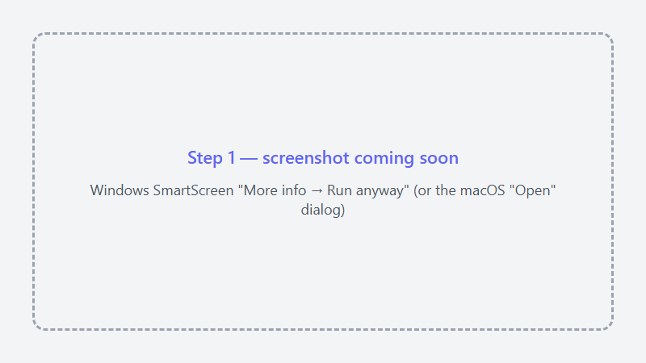
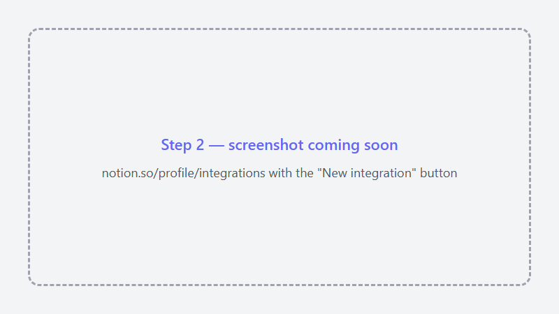
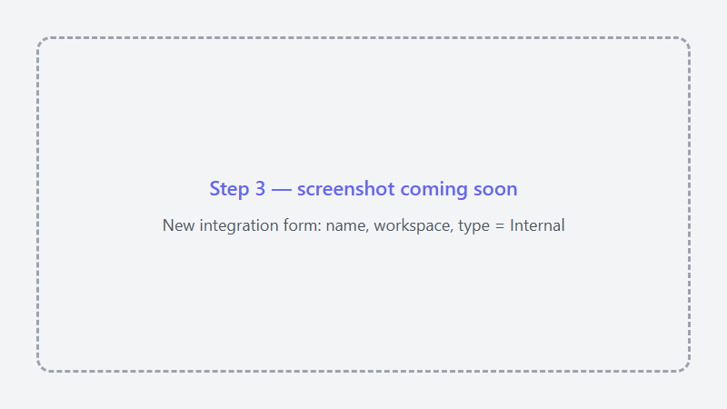
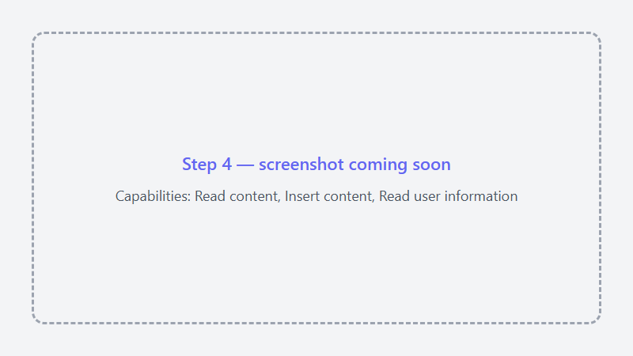
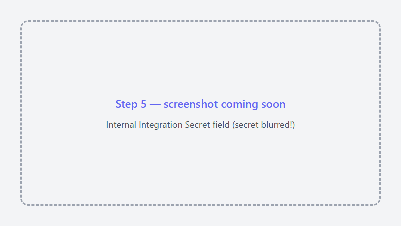
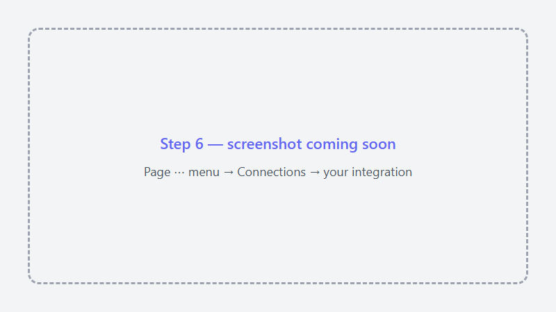
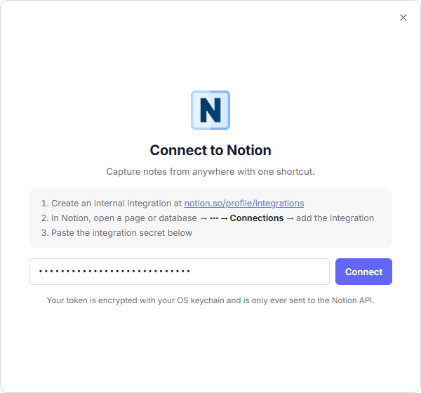
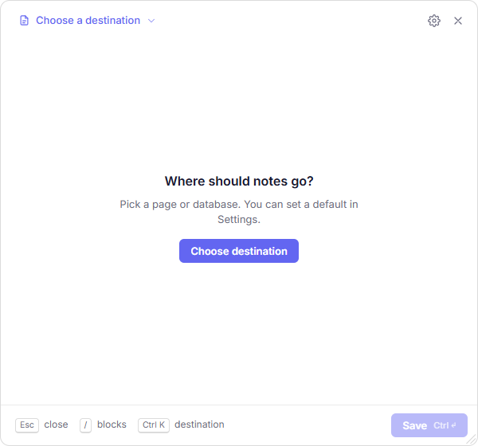

# Connect Notion Quick Capture to Notion

This guide takes you from a fresh download to your first note in Notion. It takes about **5 minutes**, and
you don't need any technical knowledge.

**What you'll do:** create a private "key" (Notion calls it an *integration*) that lets the app add pages to
your Notion, choose which pages it may use, and paste the key into the app.

> **Is this safe?** The key only works for the pages you share with it — nothing else in your workspace.
> It stays on your computer, encrypted by your operating system, and is only ever sent to Notion.
> You can switch it off at any time (see [Disconnect or replace your key](#disconnect-or-replace-your-key)).

**Contents**

1. [Install the app](#step-1--install-the-app)
2. [Open Notion's integrations page](#step-2--open-notions-integrations-page)
3. [Create the integration](#step-3--create-the-integration)
4. [Choose what it may do](#step-4--choose-what-it-may-do)
5. [Copy the secret key](#step-5--copy-the-secret-key)
6. [Share a page with the integration](#step-6--share-a-page-with-the-integration)
7. [Paste the key into the app](#step-7--paste-the-key-into-the-app)
8. [Choose where notes go](#step-8--choose-where-notes-go)
9. [Capture your first note](#step-9--capture-your-first-note)
- [Troubleshooting](#troubleshooting)

---

## Step 1 — Install the app

1. Open the [latest release](https://github.com/somaraj/notion-quick-capture/releases/latest) and download
   the file for your computer:
   - **Windows:** `notion-quick-capture-setup-<version>.exe`
   - **Mac with Apple chip (M1, M2, …):** `…-mac-arm64.dmg` · **Older Intel Mac:** `…-mac-x64.dmg`
     (not sure? Apple menu  → **About This Mac** → look at "Chip")
   - **Linux:** `….AppImage` (works on most distributions) or `….deb` (Ubuntu, Debian)
2. Run the installer.

Your computer may warn you the first time, because the app is not yet code-signed. That's expected:

| | What you see | What to do |
|---|---|---|
| **Windows** | "Windows protected your PC" | Click **More info**, then **Run anyway** |
| **macOS** | "cannot be opened because the developer cannot be verified" | Drag the app into **Applications**, then **right-click** it → **Open** → **Open** |
| **Linux** | The AppImage doesn't start | Right-click it → **Properties** → allow **executing as a program** |

Once it's running, the app lives in your **system tray** (Windows: bottom-right, near the clock;
macOS: the menu bar at the top; Linux: your panel's tray area). It has no main window — that's normal.

## Step 2 — Open Notion's integrations page

1. In your web browser, sign in to Notion and go to
   **[notion.so/profile/integrations](https://www.notion.so/profile/integrations)**.
   (From the Notion app: **Settings** → **Connections** → **Develop or manage integrations**.)
2. Click **New integration** (or **+ New integration**).

> You need to be a **Workspace Owner** to create integrations. If you don't see the button, ask the owner of
> your workspace — or use a personal workspace.

## Step 3 — Create the integration

Fill in the form:

- **Integration name:** anything you like, e.g. `Quick Capture`
- **Associated workspace:** the workspace you want to save notes in
- **Type:** **Internal**

Click **Save**, then **Configure integration settings** (or open the new integration from the list).

## Step 4 — Choose what it may do

On the integration's page, find **Capabilities** and make sure these are ticked:

- ✅ **Read content** — so the app can list your pages and databases
- ✅ **Insert content** — so it can add your notes
- ✅ **Read user information without email addresses** — only needed for *People* fields in databases

Leave the rest unticked and click **Save changes**.

## Step 5 — Copy the secret key

On the same page, find **Internal Integration Secret**, click **Show**, then **Copy**.
It's a long code starting with `ntn_` (older ones start with `secret_`).

> 🔒 **Treat this like a password.** Don't post it in chats, screenshots or GitHub issues. Anyone who has it can
> add to the pages you share in the next step.

## Step 6 — Share a page with the integration

The integration can't see anything yet — you decide which pages it may use.

1. In Notion, open the page or database where you want your notes to go (for example a page called *Inbox*).
2. Click **⋯** (top-right corner) → **Connections** (may be shown as **Add connections**).
3. Search for your integration's name (`Quick Capture`) and select it, then click **Confirm**.

**Tips**

- Sharing a page also shares **everything inside it**. Sharing one top-level page (e.g. *Inbox*) is the
  easiest way to start.
- Repeat this for every page or database you want to capture to.
- Alternative: on the integration's settings page, open the **Access** tab and pick pages there.

## Step 7 — Paste the key into the app

1. Press <kbd>Ctrl</kbd>+<kbd>Shift</kbd>+<kbd>N</kbd> (Mac: <kbd>⌘</kbd>+<kbd>⇧</kbd>+<kbd>N</kbd>),
   or click the tray icon → **Open Capture**.
2. Paste the secret key from step 5 into the box and click **Connect**.

If it says Notion didn't accept the token, see [Troubleshooting](#troubleshooting).

## Step 8 — Choose where notes go

After connecting, the app asks **"Where should notes go?"**. Click **Choose destination** and pick the page or
database you shared in step 6 — you can type to search.

This becomes your **default destination**. You can change it later in **Settings → General → Default
Destination** (tray icon → **Settings**), or send a single note somewhere else with
<kbd>Ctrl</kbd>/<kbd>⌘</kbd>+<kbd>K</kbd>.

## Step 9 — Capture your first note

1. Type a title and your note. Formatting works as in Notion: `# ` for a heading, `- ` for a list,
   `[] ` for a to-do, or press <kbd>/</kbd> for a menu.
2. Press <kbd>Ctrl</kbd>/<kbd>⌘</kbd>+<kbd>Enter</kbd> to save.
3. Click **Open in Notion** to see it.

🎉 **You're done.** From now on, press the shortcut from any app, type, save, and carry on.

If you're offline when you save, the note is kept and sent automatically when you're back online.

---

## Troubleshooting

| Problem | Fix |
|---|---|
| **"Notion did not accept that token"** | Copy the secret again (step 5) — make sure you got all of it and no spaces. Check your internet connection. |
| **No pages appear when choosing a destination** | The integration hasn't been given access to anything yet. Do [step 6](#step-6--share-a-page-with-the-integration), then search again. |
| **A page I want is missing from the list** | Share that page (or a page above it) with the integration — step 6. |
| **Saving fails with a permission error** | Make sure **Insert content** is ticked (step 4) and the destination is shared with the integration. |
| **People fields are empty or show an error** | Tick **Read user information** in step 4. |
| **The shortcut does nothing** | Another app may already use it. Change it in **Settings → Shortcuts**. |
| **Notes go to the wrong workspace** | An integration belongs to one workspace. Create one in the right workspace (step 3) and connect with its key. |
| **Linux: "secret service" or keyring warning** | Install and unlock GNOME Keyring or KWallet (most desktops have one) so the key can be stored encrypted. |

Still stuck? [Open an issue](https://github.com/somaraj/notion-quick-capture/issues/new/choose) — describe what
you see, but **never include your secret key**.

## Disconnect or replace your key

- **In the app:** tray icon → **Settings** → **General** → **Disconnect**. This deletes the key from your computer.
- **In Notion** (stops the key working everywhere): open
  [notion.so/profile/integrations](https://www.notion.so/profile/integrations), select your integration, and
  either **refresh** the secret (then paste the new one into the app) or **delete** the integration.
- To stop access to one page only, open it → **⋯** → **Connections** → remove the integration.
